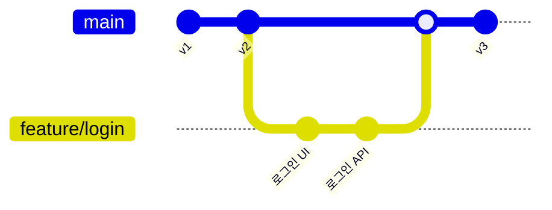
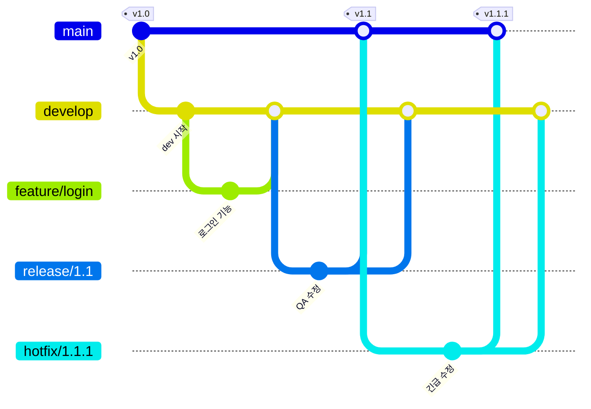
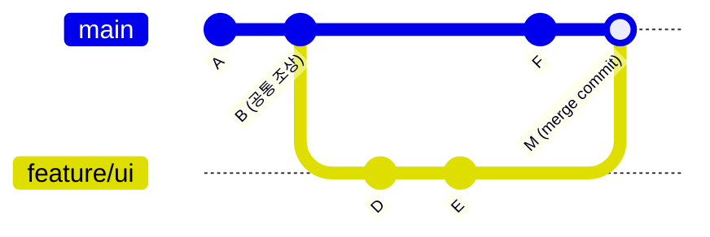

# Git & GitHub 요점 정리

## 1. Git / GitHub

### 1.1 Git & GitHub를 사용해야 하는 이유

**버전 관리(Version Control)** 란 파일이나 코드의 변경 이력을 체계적으로 기록하고 관리하는 것. **언제, 누가, 무엇을** 바꿨는지 알 수 있고, 필요하면 과거 상태로 되돌릴 수 있음.

| 이유 | 설명 |
|---|---|
| **1. 버전 관리** | 변경 이력을 추적하고, 실수로 코드를 망가뜨려도 이전 정상 버전으로 바로 되돌릴 수 있음 |
| **2. 협업 용이** | 여러 명이 각자 브랜치에서 동시에 작업한 뒤 병합(merge), 코드 리뷰로 피드백 |
| **3. 백업 및 중앙 집중화** | GitHub가 클라우드 중앙 저장소 역할 → 로컬 컴퓨터가 고장 나도 코드 보존 |
| **4. 오픈소스 · 공개 협업** | 오픈소스 프로젝트 참여, 개인 프로젝트 공유 및 피드백 |
| **5. CI/CD · 자동화** | push하면 자동으로 테스트·배포하는 도구와 연동 (예: GitHub Actions) |
| **6. 문서화 · 프로젝트 관리** | README로 문서화, Issue로 할 일·버그 관리 |

#### 파일 복사 방식 vs Git

| 파일 복사 방식 | Git 사용 |
|---|---|
| `final.py`, `final_v2.py`, `진짜최종.py`… 파일이 계속 늘어남 | 변경 내용이 **커밋 단위**로 기록됨 |
| 변경 이유와 내용이 남지 않음 | 언제든 특정 시점으로 되돌릴 수 있음 |
| 협업 시 어떤 파일이 최신인지 알기 어려움 | 여러 사람이 동시에 작업 가능, 변경 이력과 책임이 명확 |

> 💡 **한 줄 요약**: 변경 이력을 추적하고, 실수를 복구하며, 여러 사람이 충돌 없이 협업하기 위해 사용.

---

### 1.2 Git과 GitHub의 차이

| 구분 | **Git** | **GitHub** |
|---|---|---|
| 정체 | 버전 관리를 위한 **도구(프로그램)** | Git 저장소를 올려두는 **웹 서비스(플랫폼)** |
| 동작 위치 | **내 컴퓨터(로컬)** 에서 동작 | **인터넷(원격 서버)** 에서 동작 |
| 주요 기능 | 커밋, 브랜치, 병합 등 이력 관리 | 코드 공유·백업, **Pull Request, Issue, Code Review** |
| 특징 | **분산형** — 각자 전체 이력 사본을 가짐 → 오프라인에서도 작업 가능 | Git으로 관리되는 프로젝트를 호스팅, 협업의 기준점 |

> 💡 **Git은 버전 관리 엔진, GitHub는 협업과 공유를 위한 서비스**
> (비유: Git = 게임의 세이브 기능, GitHub = 세이브 파일을 올려 두는 클라우드)

---

### 1.3 Repository

**Repository(레포지토리, 저장소)**: 파일과 그 **변경 이력을 함께** 관리하는 저장소. 프로젝트 전체와 모든 버전 기록이 들어 있음.

| 종류 | 위치 | 만드는 방법 |
|---|---|---|
| **로컬 저장소** | 내 컴퓨터 | 프로젝트 폴더로 이동 → `git init` |
| **원격 저장소** | GitHub 같은 서버 | GitHub에서 New Repository 생성 → `git clone URL`로 내 컴퓨터에 복사 |

#### Git의 3가지 작업 영역

```
 Working Directory  ──git add──▶  Staging Area  ──git commit──▶  Repository(.git)  ──git push──▶  원격 저장소(GitHub)
  (실제 작업 공간)                (커밋 대기 공간)                  (버전 기록)          ◀──git pull──
```

- **Working Directory**: 실제로 파일을 수정하는 공간. 아직 Git에 기록되지 않은 변경 사항이 있는 상태
- **Staging Area**: 다음 커밋에 포함할 변경 사항을 **선별해 모아두는** 공간
- **Repository**: 커밋된 버전들이 저장되는 곳 (`.git` 폴더)

#### `.git` 폴더

- `git init` 또는 `git clone` 시 생성되는 **숨겨진 폴더** (macOS Finder에서 `Command + Shift + .`로 표시)
- 모든 커밋·브랜치·태그·설정이 들어 있는 **Git의 데이터베이스**
- ☠️ 삭제하면 버전 관리 정보가 모두 사라짐
- ⚠️ 최상위 폴더에 **딱 하나만** 있어야 함 (하위 폴더에 중복으로 있으면 충돌의 원인)

#### `.gitignore`

버전 관리에서 **제외할 파일**을 지정하는 설정 파일 (환경 변수, 빌드 결과물, 개인 설정 파일 등)

```gitignore
.env
__pycache__/
*.log
.DS_Store
```

> ⚠️ 이미 커밋된 파일은 계속 추적되므로 `git rm --cached 파일명`으로 추적을 해제해야 함.

---

### 1.4 Commit

**Commit(커밋)**: 변경 사항을 **하나의 기록으로 저장하는 단위** (= 하나의 버전, 게임의 save file)

- "무엇을 왜 바꿨는지"를 **메시지**로 남김
- 특정 시점의 프로젝트 상태를 저장
- 되돌아갈 수 있는 **기준점** 역할
- 각 커밋은 고유한 **해시 값**(예: `719bd42`)으로 식별

```bash
git commit -m "회원가입 기능 추가"
# [main 719bd42] first commit
#  1 file changed, 11 insertions(+)
#  create mode 100644 day_1/sample.html
```

#### 커밋 메시지 작성 규칙

좋은 커밋 메시지는 **무엇을 했는지 한눈에** 알 수 있어야 함.

- 명확하고 간결하게 작성
- **동사로 시작** (Add, Fix, Update, Refactor, Remove …)
- **한 커밋 = 한 작업**

```
Add login API
Fix password validation bug
Refactor user service
```

#### HEAD

- **현재 내가 작업 중인 위치를 가리키는 포인터**
- 보통 현재 브랜치의 최신 커밋을 가리킴 → HEAD가 움직이면 작업 기준이 바뀜
- `HEAD~1`(=`HEAD^`): 한 단계 이전 커밋, `HEAD~3`(=`HEAD^^^`): 세 단계 이전 커밋

---

### 1.5 Branch

**Branch(브랜치)**: 기존 작업과 분리된 **독립적인 작업 공간(흐름)**

- 기존 코드를 건드리지 않고 기능 개발·실험·수정 가능
- 여러 기능을 **동시에** 개발할 수 있음
- 작업이 끝나면 **병합(merge)** 함
- 협업과 안정적인 배포를 위해 브랜치를 잘 관리하는 것이 중요



---

## 2. git 기본 명령어

### 전체 흐름 한눈에 보기

```bash
# 사용자 설정 (최초 1회만 함)
git config --global user.name "이름"
git config --global user.email "메일"

# 저장소 초기화 (폴더마다 1회만 함)
git init

# 원격 저장소에 연결하기
git remote add origin <원격저장소 URL>

# 기본 브랜치 이름을 main으로 변경
git branch -M main

# 상태 확인
git status

# 스테이징                                    
git add .

# 커밋
git commit -m "커밋할 메시지 내용 기재"

# 업로드 후 git에 push(올리기)
git push -u origin main

# 변경된 내용 원격으로 내려받기
git pull
```

---

### 2.1 git config

Git의 기본 동작(사용자 이름, 이메일 등)을 **설정**하는 명령어. 이름·이메일은 **커밋 작성자 정보**로 기록됨.

| 범위 | 명령어 | 적용 대상 |
|---|---|---|
| **전역(global)** | `git config --global user.name "홍길동"` | 내 컴퓨터의 **모든 저장소** |
| | `git config --global user.email "hong@example.com"` | |
| **로컬(local)** | `git config user.name "홍길동"` | **현재 저장소에만** (회사/개인 계정 구분 시) |

```bash
# 새 저장소의 기본 브랜치를 메인으로 변경
git config --global init.defaultBranch main

# 전체 설정 확인하기
git config --list

# 특정 항목만 확인하기
git config --get user.name

# 설정 삭제하기
git config --global --unset user.name
```

> ⚠️ 따옴표를 한쪽만 닫으면 `dquote>`가 계속 뜸 → `Ctrl + C` 또는 `Ctrl + G`를 통해 빠져나온 후에 다시 입력을 시도해야 함

---

### 2.2 git init

**현재 폴더를 Git 저장소로 초기화**하는 명령어

```bash
mkdir new_project
cd new_project
git init
```

- `.git` 폴더가 생성되고, 현재 폴더를 기준으로 버전 관리가 시작됨
- ⚠️ 한 프로젝트 폴더에서 **딱 한 번만** 실행
- 이미 GitHub에 있는 저장소를 가져올 때는 `git init` 대신 `git clone <URL>` 사용 (원격 저장소가 `origin`으로 자동 연결됨)

---

### 2.3 git status

**현재 저장소의 상태**를 확인하는 명령어

```bash
# 상태 보기
git status

# 간단 상태 보기
git status -s
```
파일 앞에 붙는 상태 보기 기호
- ??: 생성 후 만들고 아직 add 안 함
- A: 새 파일을 add 완료
- M(오른쪽일 때): 기존 파일 수정 후 add 안 함
- M(왼쪽일 때): 기존 파일 수정 후 add까지 완료
- MM(양쪽에 다 있을 때): dd한 후에 또 수정함

확인할 수 있는 것:
- 수정된 파일 / 새로 생긴(untracked) 파일
- 스테이징 여부 (빨간색 = 스테이징 안 됨, 초록색 = 스테이징 됨)
- 커밋 가능한 변경 사항
- 현재 브랜치와 원격 브랜치의 동기화 상태 (`Your branch is up to date with 'origin/main'`)

> 💡 add, commit, push 전후로 습관처럼 `git status`를 확인할 것.

---

### 2.4 git add

변경된 파일을 **Staging Area로 올리는** 명령어 (커밋에 포함할 변경 사항을 **선택**하는 단계)

```bash
# 특정 파일만 add
git add index.html

# 특정 디렉토리 전체 add
git add src/

# 하위 디렉토리를 포함한 현재 디렉토리의 모든 변경 사항 add
git add .
```

- 아직 커밋이 생성된 것은 **아님**
- 스테이징 취소: `git reset 파일명` (또는 `git restore --staged 파일명`)

---

### 2.5 git commit

Staging Area에 있는 변경 사항을 **하나의 버전으로 기록**하는 명령어

```bash
# 에디터 열기
git commit

# 메시지 바로 입력
git commit -m "커밋 메시지 내용"

# 기존 파일의 add와 commit 한번에 하기
git commit -am "커밋 메시지 내용"

# 마지막 커밋 수정하기
git commit --amend -m "새 메시지 내용"
```

커밋 이력 확인:

```bash
# 해시, 작성자, 날짜, 메시지 확인
git log

# 한 줄로 이력 확인하기
git log --oneline

# 브랜치 흐름 그래프로 확인하기
git log --oneline --graph
```

---

### 2.6 git push

**로컬 커밋을 원격 저장소로 업로드**하는 명령어

```bash
# 원격 저장소 이름을 origin으로 등록하기
git remote add origin <원격저장소 URL>

# 연결된 원격 저장소 확인
git remote -v

# main을 origin에 올리고 upstream(추적 관계) 설정
git push -u origin main

# -u로 설정했을 경우 생략 가능
git push

# 다른 브랜치를 원격에 올리기
git push origin feature/mybranch
```

- `origin` = 원격 저장소의 별칭(기본 이름), `main` = 올릴 브랜치
- `-u`(`--set-upstream`): 로컬 브랜치와 원격 브랜치를 연결해서 다음부터 `git push`/`git pull`만 입력해도 됨
- 원격에 내 로컬에 없는 커밋이 있으면 push가 거절됨 → 먼저 `git pull`로 받아온 뒤 push

---

### 2.7 git pull

**원격 저장소의 변경 사항을 내려받아 로컬에 반영**하는 명령어

```bash
# upstream이 설정된 원격 브랜치에서 받아오기
git pull

# origin의 main 브랜치를 받아와 현재 브랜치에 합치기
git pull origin main

# (Fork 협업) 원본 저장소의 최신 코드 받기
git pull upstream main
```

- `git pull` = **`git fetch`(원격 내용 가져오기) + `git merge`(현재 브랜치에 병합)**
- 다른 사람이 push했거나 GitHub 웹에서 직접 수정한 내용을 내 컴퓨터에 반영할 때 사용
- 병합 과정이므로 같은 부분을 서로 다르게 고쳤다면 **충돌(conflict)** 이 날 수 있음

> 💡 **작업 시작 전 `git pull`, 작업 끝나면 `git push`** 가 협업의 기본 습관

#### (참고) Clone vs Fork

| Clone | Fork |
|---|---|
| 원격 저장소를 그대로 **내 로컬로** 복사 | 다른 사람의 저장소를 **내 GitHub 계정으로** 복사 |
| 같은 저장소에 push 권한이 있을 때 | 원본 저장소에 push 권한이 없을 때 |
| 팀 내부 협업 | 오픈소스 기여 → Pull Request |

---

## 3. Branch

### 3.1 git branch 명령어

| 명령어 | 설명 |
|---|---|
| `git branch` | 브랜치 목록 확인 (`*` = 현재 브랜치) |
| `git branch -a` | 원격 브랜치까지 모두 확인 |
| `git branch feature/ui` | 브랜치 생성 (현재 브랜치는 그대로) |
| `git switch feature/ui` | 브랜치 전환 (= `git checkout feature/ui`) |
| `git switch -c feature/ui` | 브랜치 생성 + 전환 (= `git checkout -b feature/ui`) |
| `git branch -m 이전이름 새이름` | 브랜치 이름 변경 |
| `git branch -M main` | 현재 브랜치 이름을 main으로 강제 변경 |
| `git branch -d feature/ui` | 브랜치 삭제 (병합된 브랜치만 삭제 가능) |
| `git branch -D feature/ui` | 병합 여부와 관계없이 강제 삭제 |
| `git merge feature/ui` | **현재 브랜치에** feature/ui의 작업 내용 병합 |
| `git push origin feature/ui` | 브랜치를 원격 저장소에 올리기 |

```bash
# 예시: 기능 브랜치에서 작업 후 main에 병합
git switch -c feature/login
# ... 작업 ...
git add .
git commit -m "Add login"
git switch main
git merge feature/login
git branch -d feature/login
```

---

### 3.2 브랜치 관리 전략 (main, develop, feature, release, hotfix)

**브랜치 관리 전략** = 어떻게 브랜치를 나누고 합칠지에 대한 팀의 약속. 대표적인 것이 **Git-flow** 입니다.

| 브랜치 | 역할 | 시작(분기) 지점 | 병합 대상 |
|---|---|---|---|
| **main** (master) | **배포 가능한 안정 버전** (제품으로 출시될 수 있는 브랜치) | — | — (출시 시 버전 태그) |
| **develop** (dev) | **다음 출시 버전을 개발**·통합 테스트하는 브랜치 | main | — (release로 넘김) |
| **feature/\*** | **기능 개발** (예: `feature/login`) | develop | develop |
| **release/\*** | **출시 준비**·QA, 자잘한 버그 수정 | develop | **main + develop** |
| **hotfix/\*** | 출시된 버전의 **긴급 버그 수정** | main | **main + develop** |

- **main, develop**: 항상 유지되는 **메인 브랜치**
- **feature, release, hotfix**: 필요할 때 만들고 병합 후 삭제하는 **보조 브랜치**
- release·hotfix를 main과 develop **양쪽**에 병합하는 이유: 수정 사항이 다음 개발 버전에도 반영되어야 하기 때문



> 💡 소규모 팀·수업 실습에서는 `main` + `feature/*`만 쓰고, PR(Pull Request)로 main에 병합하는 단순한 방식(GitHub Flow)도 많이 사용함.

---

### 3.3 Fast-forward merge

**분기가 없을 때** (병합할 브랜치가 현재 브랜치의 **직계 후손**일 때)

- 새 커밋을 만들지 않고 **브랜치 포인터만 앞으로 이동**
- 히스토리가 **일직선**으로 유지됨

```
병합 전                              병합 후 (git switch main → git merge feature/ui)
main                                 
 ↓                                                       main, feature/ui
 A ── B ── C ── D                     A ── B ── C ── D     ↓
           ↑                                         (main 포인터만 D로 이동)
       feature/ui
```

```bash
# 기본값(--ff): 가능하면 fast-forward
git merge feature/ui

# Updating 1a2b3c4..5d6e7f8
# Fast-forward

# fast-forward가 가능해도 병합 커밋을 만들어 병합 기록 남기기
git merge --no-ff feature/ui
```

---

### 3.4 3-way merge

**분기가 있을 때** (두 브랜치가 갈라진 뒤 각각 커밋이 쌓였을 때)

- Git이 **3개의 커밋**을 비교해서 병합
  1. 두 브랜치의 **공통 조상** 커밋
  2. 현재 브랜치(main)의 최신 커밋
  3. 병합할 브랜치(feature)의 최신 커밋
- 결과로 **병합 커밋(merge commit)** 이 새로 생성됨 → 부모가 **2개**인 커밋

```
병합 전                               병합 후
          D ── E  ← feature/ui                  D ── E  ← feature/ui
         /                                     /      \
A ── B ── C ── F  ← main              A ── B ── C ── F ── M  ← main (병합 커밋)
          ↑
      공통 조상
```



> 💡 **분기가 없으면 Fast-forward, 분기가 있으면 3-way merge**

---

### 3.5 Merge conflict

**같은 파일의 같은 부분을 서로 다르게 수정**하고 병합하면 Git이 자동으로 합치지 못해 **충돌**이 발생함.
Git은 자동 병합을 먼저 시도하고, **사람의 판단이 필요한 경우에만** 충돌로 알려줌.

#### 충돌 재현 실습

```bash
git init
echo "hello" > test.txt
git add .
git commit -m "first commit"

# feature 브랜치에서 수정
git branch feature
git switch feature
echo "hello from feature" > test.txt
git add .
git commit -m "update from feature"

# main에서 같은 줄을 다르게 수정
git switch main
echo "hello from main" > test.txt
git commit -am "update from main"

# 병합 시도 → 충돌!
git merge feature
# CONFLICT (content): Merge conflict in test.txt
# Automatic merge failed; fix conflicts and then commit the result.
```

#### 충돌 마커 읽는 법

```text
<<<<<<< HEAD
hello from main          ← 현재 브랜치(merge를 실행한 쪽, main)의 내용
=======
hello from feature       ← 병합하려는 브랜치(feature)의 내용
>>>>>>> feature
```

#### 해결 방법

1. **충돌 파일 확인** — `git status`에서 `both modified`(unmerged)로 표시된 파일
2. **충돌 코드 직접 수정** — 둘 중 하나를 고르거나 둘을 합쳐 새로 작성하고, `<<<<<<<`, `=======`, `>>>>>>>` 마커를 **모두 삭제**
3. **새로운 커밋 생성** — `git add` 후 `git commit`

```bash
# 충돌 내용 확인
cat test.txt

# 파일 수정 (VS Code에서는 Accept Current / Incoming / Both 버튼 사용 가능)
vi test.txt
git add test.txt
git commit -m "resolve merge conflict"

# 병합 결과 확인
git log --oneline --graph

# 병합 전 상태로 되돌리기
git merge --abort
```

> 💡 충돌을 줄이는 습관: 작업 전 `git pull`로 최신화, 브랜치는 작게·자주 병합, 같은 파일을 동시에 크게 수정하지 않도록 주의할 것.